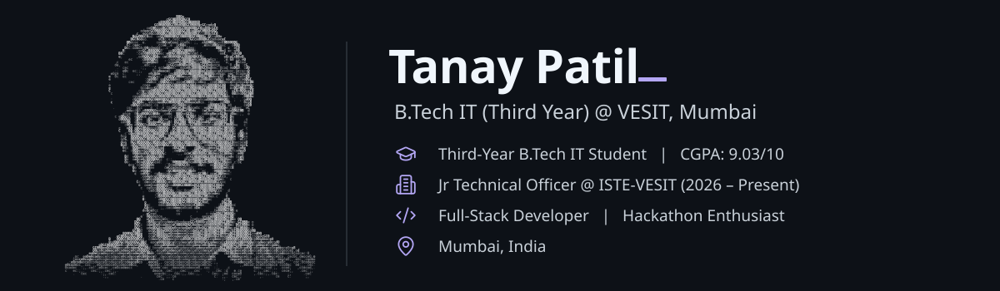
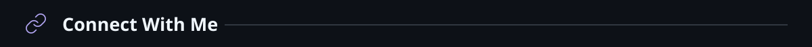
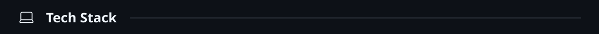
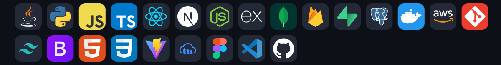
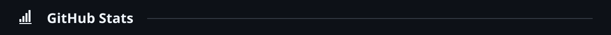
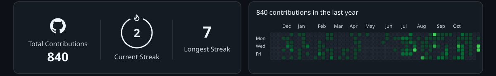
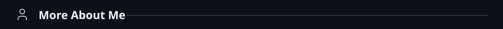
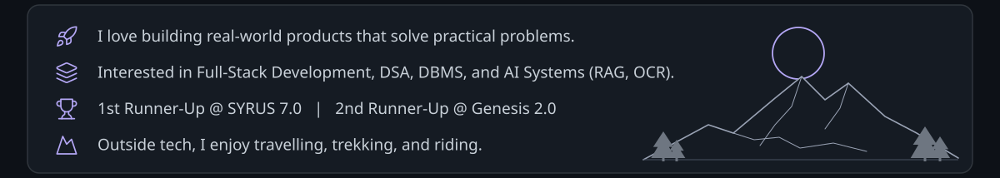

<!-- Every section is a hand-built SVG in /assets (see /scripts). GitHub strips CSS from READMEs,
     so drawing each block as an image is the only way to get this exact layout. -->

&nbsp;&nbsp;&nbsp;&nbsp;&nbsp;&nbsp;
&nbsp;&nbsp;
&nbsp;&nbsp;

